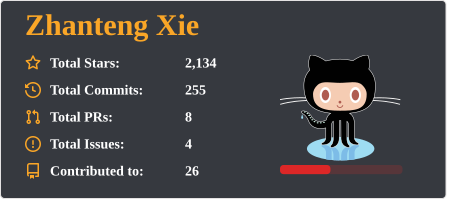

# GitHub 统计卡片：直接从 GitHub 自动更新

## 这版解决了什么

保留原 Octocat 卡片、slateorange 配色和红色进度条。定时任务直接请求 `https://api.github.com/graphql`，在自己的仓库里计算统计、生成 SVG 并提交。运行时不再访问 awesome-github-stats 的 Azure 网站，也不请求它的 `/stats` 或 `/rank` 接口。

README 读取仓库中的 `profile/github-stats.svg`。即使某次数据更新失败，已经提交的正常图片仍可显示。

## 安装与第一次运行

1. 解压修复包。将 `.github/`、`scripts/`、`assets/`、`profile/` 按原有目录结构提交到 `zzuxzt/zzuxzt` 的 `master` 分支。`tests/` 包含统计与失败保护测试，也可以一并提交。不要把 ZIP 本身当作工作流上传。
2. 将主页 README 中的统计卡片行改成：

```markdown
[](https://github.com/zzuxzt)
```

3. 打开仓库 **Actions → Update GitHub stats**。首次提交脚本或工作流会触发执行，也可以点击 **Run workflow** 手动执行。确认首次执行为绿色后，检查提交记录和 `profile/github-stats.json`：成功直接读取 GitHub 后，`source_url` 应为 `https://api.github.com/graphql`，`retrieval_mode` 应为 `github-api`，时间应为这次运行时间。

包内 `README.md` 是上一轮读取的主页内容，仅修改了统计卡片行。如果你已经更新了其他介绍内容，只替换上面这一行即可。

## 自动更新频率

工作流每天 UTC 01:17（北京时间 09:17）运行。GitHub 的计划任务可能延迟，更新后的图片也可能短暂经过 GitHub 的图片缓存。这是每天刷新的一张仓库图片。

定时工作流必须存在于默认分支。若公共仓库连续 60 天没有活动，GitHub 可能自动停用计划任务；届时在 Actions 页面重新启用。

## GitHub 令牌

默认使用 GitHub Actions 自动提供的 `github.token`，不需要把令牌写进代码。工作流通过 `contents: write` 给自动提交提供权限。

也支持一个可选仓库 Secret：`GH_STATS_TOKEN`。存在时，仅数据查询步骤会优先使用它；提交文件仍由 checkout 使用的 Actions 令牌完成。

如果第一次运行报 `Resource not accessible by integration`、`Bad credentials` 或权限错误，请先按实际错误确认权限。只有在自动令牌确实无法完成用户贡献查询时，再在 **Settings → Secrets and variables → Actions** 中配置有相应查询权限的 `GH_STATS_TOKEN`，然后重新运行。不要把令牌放进 README、脚本或聊天内容。是否需要额外令牌，以仓库首次执行结果为准；本地环境没有你的 GitHub 认证凭据，因此没有声称已完成真实的认证运行。

如果错误发生在 `git push`，应检查仓库/组织的 Actions 写权限和分支保护，并按既有合入流程处理。

## Stars 怎样计算

保留原服务的核心定义：收集账号各年度的代码提交与 Pull Request 涉及的仓库，按稳定的 GitHub 仓库 ID 把同一个仓库在不同年份、不同贡献类型中的出现去重，再累加这些仓库当前的 `stargazerCount`。

- 自己名下的入选仓库归为 Direct Stars。
- 其他个人或组织名下的入选仓库归为 Indirect Stars。
- 卡片 Total Stars = Direct Stars + Indirect Stars。
- 仓库归属按真实 `owner.login` 判断，避免旧实现使用字符串包含判断时的误分组。
- 仅创建仓库、发 Issue、写 Review 或 Fork 一个项目，不会单独把那个项目的 Stars 纳入此集合。
- 一个仓库的全部 Stars 被计入贡献仓库总量，不按个人贡献比例分摊。

查询显式请求每年每类至多 100 个贡献仓库，并与 GitHub 的对应仓库总数核对。如果发现列表截断、缺字段、GraphQL 错误或统计不一致，会停止更新，不会把少计结果写成正常卡片。`profile/github-stats.json` 在成功运行后包含去重后的仓库明细，便于复核 Stars 来源。

原服务默认每年每类最多 25 个仓库，且有缓存；新脚本使用更大的查询上限和实际仓库归属。数据随 GitHub 更新、API 可见性和上游旧限制改变，第一次直接重算的数字可能与旧快照不同。脚本不会把 2,131 固定写死。

其余统计和等级按原项目兼容逻辑生成，细节保存在输出 `data.source` 的说明中。默认以 API 可访问的公开统计为基础；不承诺读取全部私有活动，也不发布私有仓库明细。

## 初始图片和数据来源

为了安装后立即有图片可显示，包内仍带有上一轮已核验的快照：Total Stars 2,131、Commits 253、PRs 8、Issues 4、Contributed to 26。它的原来源时间是北京时间 2026-11-23 20:58:01。

这张初始图不代表新 GitHub API 脚本已经在线成功运行。首次工作流成功后，会由 GitHub 当时的数据替换；旧来源只作为历史快照元数据保留，不会被更新脚本调用。

## 本地运行与检查

需要 Python 3.10 或以上，仅使用标准库。在线运行时在环境中设置 `GITHUB_TOKEN` 或 `GH_TOKEN`，然后：

```bash
python3 scripts/render_github_stats.py
```

离线重新渲染已有快照，不发送任何网络请求：

```bash
python3 scripts/render_github_stats.py --snapshot profile/github-stats.json
```

运行测试：

```bash
python3 -m unittest discover -s tests -v
```

## 验证范围

交付前已通过 10 项计算和失败保护检查，覆盖跨年份/Commit-PR 去重、仓库改名后的 ID 去重、间接 Stars、旧等级权重、日期边界、截断/缺失数据拒绝、权限错误、私有身份保护和失败时保留旧数据；另已检查渲染入口、计划任务和令牌配置。这里没有你的 GitHub 凭据，也不能替你的仓库生成 Actions 运行令牌，真实 GitHub API 鉴权与自动提交仍需要以上首次工作流执行确认。

## 官方参考与许可

- GitHub 用户贡献字段：<https://docs.github.com/en/graphql/reference/users#contributionscollection>
- GitHub Actions 认证：<https://docs.github.com/en/actions/tutorials/authenticate-with-github_token>
- 定时任务：<https://docs.github.com/en/actions/reference/workflows-and-actions/events-that-trigger-workflows#schedule>
- 原开源模板与算法：<https://github.com/brunobritodev/awesome-github-stats>
- 原项目 MIT 许可证保存在 `assets/awesome-github-stats-LICENSE.txt`。

模板和等级配置已经随包提供；运行时不从第三方网站下载模板、字体或配置。
